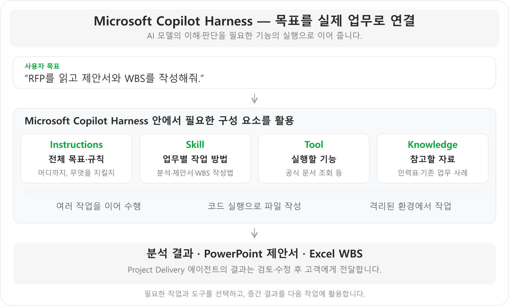

# Microsoft Copilot Harness 개요

**학습 목표:** Microsoft Copilot Harness로 어떤 일을 할 수 있는지 알고, Project Delivery 에이전트에서 선택한 이유를 확인합니다.

{: .note }
교안은 변경된 명칭인 **Microsoft Copilot Harness**를 사용합니다. 일부 화면 캡처에는 이전 명칭인 GitHub Copilot이 표시될 수 있습니다. [공식 명칭 안내](https://www.microsoft.com/en-us/copilot/blog/copilot-studio/the-github-copilot-harness-in-copilot-studio-is-now-the-microsoft-copilot-harness/)

## 1. Microsoft Copilot Harness로 할 수 있는 일

**Microsoft Copilot Harness는 Copilot Studio의 에이전트가 여러 단계의 업무를 수행하도록 돕는 실행 환경입니다.** 에이전트는 자연어로 설명한 목표와 규칙에 따라 필요한 Skill·도구·자료를 활용해, 정보 확인부터 문서 파일 작성까지 처리할 수 있습니다.

그림의 네 가지 요소를 연결해 업무를 구성합니다. **Instructions는 전체 규칙, Skill은 작업 방법, Tool은 실행 기능, Knowledge는 참고 자료**입니다. 각 요소의 등록 방법은 뒤의 Step에서 직접 확인합니다.

Microsoft Copilot Harness에서는 자연어로 목표와 원칙을 설명하고, 업무별 Skill을 재사용하며, 내장 코드 실행으로 파일을 읽고 작성·편집할 수 있습니다. 작업은 Copilot Studio의 관리 체계 안에서 격리된 환경으로 실행합니다. [공식 에이전트 개요](https://learn.microsoft.com/en-us/microsoft-copilot-studio/agents-experience/overview), [공식 하네스 안내](https://learn.microsoft.com/en-us/microsoft-copilot-studio/harnesses-overview)

## 2. Project Delivery 에이전트에서 선택한 이유

Project Delivery 에이전트는 **고객 요구사항을 읽는 일부터 최종 문서 파일 작성까지** 연결해야 합니다. 아래 세 가지를 기준으로 Microsoft Copilot Harness를 선택했습니다.

| Project Delivery 에이전트에 필요했던 일 | Microsoft Copilot Harness를 선택한 이유 |
|---|---|
| 분석 내용을 중간 작업 계획·제안서·상세 WBS에 이어 사용 | 여러 작업을 연결하고 중간 결과를 다음 작업에서 활용하는 방식에 적합 |
| 인력 자료와 공식 기술 문서를 확인하며 업무별 방법 적용 | 분석·제안서·WBS Skill과 필요한 도구·지식을 함께 활용 가능 |
| 고객에게 전달할 PowerPoint·Excel 초안 작성 | 파일 생성·편집을 지원하며, 실제 구축에서 비교한 내용·디자인 품질도 만족스러웠음 |

**선택의 핵심은 질문에 답하는 것에서 끝나지 않고, 자료를 확인해 문서 파일까지 작성하는 업무라는 점입니다.** 파일 품질 평가는 Project Delivery 에이전트의 실제 구축 경험이며, 생성 후에는 사람이 내용을 검토·수정합니다.

Project Delivery 에이전트는 Microsoft Copilot Harness로 구성합니다. Standard와의 차이는 아래 부록에서 참고할 수 있습니다.

실습에 사용할 파일과 자료의 용도는 [홈의 ‘사용할 자료’]({{ '/' | relative_url }}#lab-materials)에서 확인합니다.

부록. Microsoft Copilot Harness와 Standard Harness 비교

### 업무에 맞는 하네스를 고를 때

Project Delivery 에이전트는 Microsoft Copilot Harness로만 구축했습니다. 아래 표는 다른 업무에 맞는 하네스를 고를 때 참고하는 비교입니다. 두 하네스는 업무를 설계하고 실행하는 중심 방식이 다릅니다. **Standard는 미리 정의한 토픽·규칙·경로가 중심이고, Microsoft Copilot Harness는 목표를 달성하기 위해 여러 단계를 수행하고 결과에 따라 조정하는 작업이 중심**입니다.

| 비교 관점 | Standard Harness | Microsoft Copilot Harness |
|---|---|---|
| 설계 중심 | 토픽·규칙·분기 등 명시적인 경로 | 목표·Instructions·Skill을 통한 단계별 업무 수행 |
| 적합한 업무 | 처리 경로가 명확한 반복 문의·구조화된 업무 | 자료와 도구를 연결해 판단해야 하는 복합 업무 |
| 실행 흐름 | 작성자가 정의한 경로를 중심으로 실행 | 목표와 중간 결과에 따라 다음 작업·도구 활용을 조정 |
| 오류·예외 대응 | 사전에 설계한 예외 경로를 중심으로 처리 | 오류 결과를 확인해 재시도·대안 경로 등으로 조정 |
| 파일 업무의 비중 | 정형 대화·규칙 기반 처리에 초점 | 업무 파일의 읽기·생성·편집을 포함한 다단계 처리에 초점 |

이 비교는 각 하네스의 설계 중심과 적합성을 설명합니다. [공식 Harness 비교](https://learn.microsoft.com/en-us/microsoft-copilot-studio/harnesses-overview)

---

<nav class="lab-page-nav" aria-label="페이지 이동">
  <a class="lab-page-nav__prev" href="{{ '/' | relative_url }}" rel="prev">이전</a>
  <a class="lab-page-nav__home" href="{{ '/' | relative_url }}">홈</a>
  <a class="lab-page-nav__next" href="{{ '/lab/agent-instructions.html' | relative_url }}" rel="next">다음</a>
</nav>
