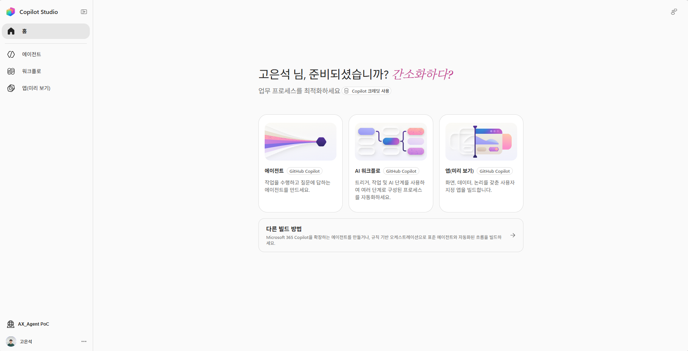
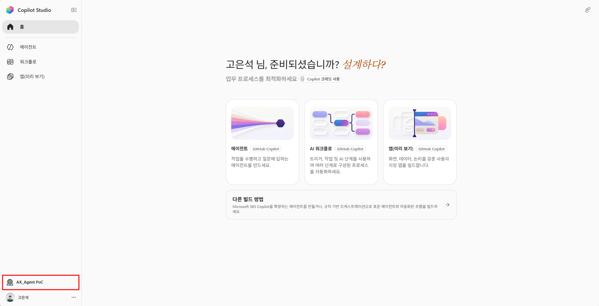
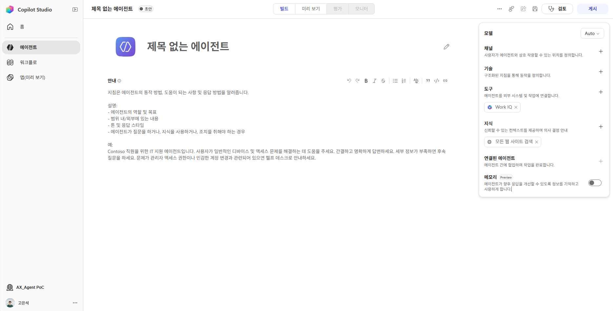
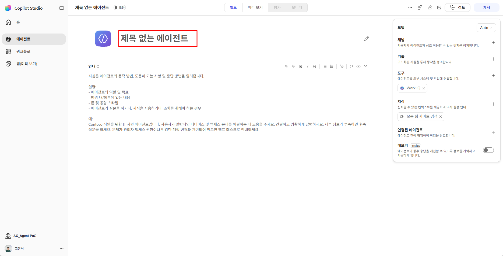
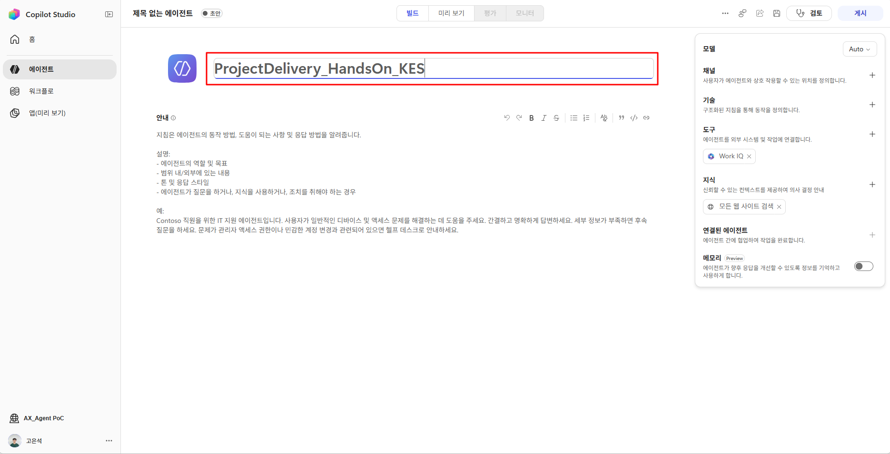
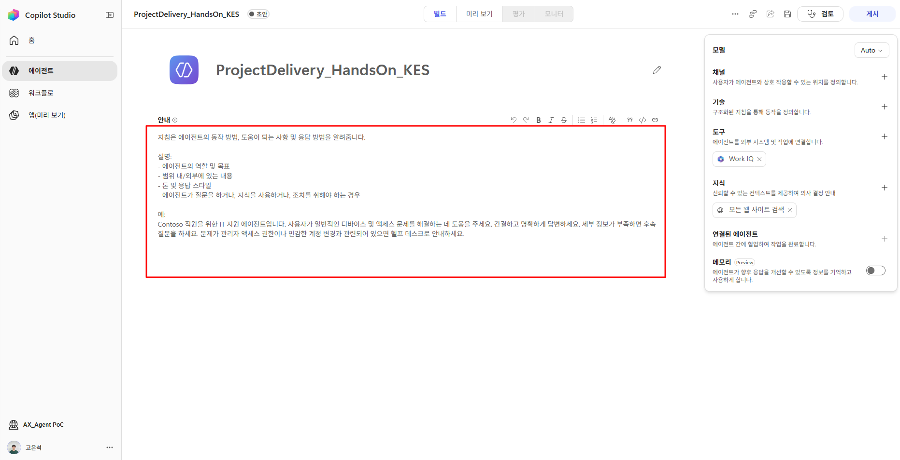
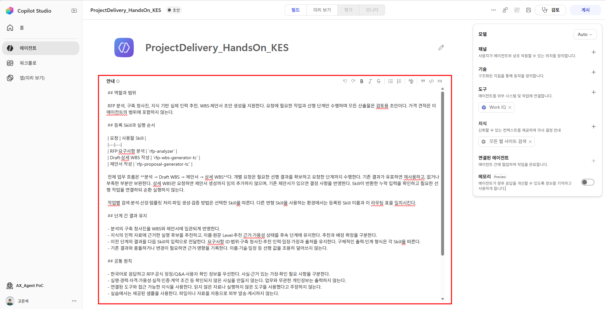
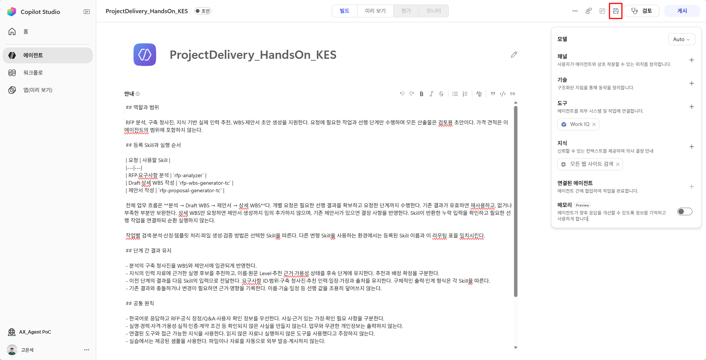

# Step1. GHCP Harness 에이전트 생성 및 Instructions 작성

**학습 목표:** GHCP 에이전트를 생성하고 이름·역할·업무 범위·공통 규칙을 입력한 뒤 저장합니다.

{: .note}
> 실습 자료 : <a href="{{ '/skills-Co/AGENT_지침.md' | relative_url }}" download>
  AGENT_지침
</a>


### 1. Copilot Studio 홈 화면과 환경 확인

1. [Copilot Studio](https://copilotstudio.microsoft.com/)에 접속하고 에이전트를 만들 권한이 있는 계정으로 로그인합니다. 로그인될 경우, 홈 화면이 표시됩니다.
    
2. 홈 화면 왼쪽 아래에서 사용할 환경을 확인합니다. 이미지의 `AX_Agent PoC`는 예시이며, 계정과 조직 설정에 따라 다른 이름이 표시됩니다.
    

**확인:** 선택한 환경의 홈 화면과 중앙의 에이전트 카드가 보입니다.

### 2. GitHub Copilot 표시가 있는 에이전트 카드 선택

1. 아래 홈 화면 이미지의 중앙 왼쪽에 있는 **에이전트** 카드를 클릭합니다. 카드 이름 옆에 **GitHub Copilot** 표시가 있습니다.
    

2. 선택 후 아래 이미지처럼 **제목 없는 에이전트**의 편집 화면이 열리는지 확인합니다.
    

GHCP 에이전트를 생성할 때 사용하는 카드입니다. 하단의 **다른 빌드 방법**과 구분해 선택합니다. 명칭 변경이 반영된 환경에서는 카드에 Microsoft Copilot 관련 이름이 표시될 수 있습니다.


### 3. 에이전트 이름 및 지침 입력

#### 에이전트 이름 입력  


1. 위 이미지에서 **상단의 빨간 테두리 안에 있는 `제목 없는 에이전트` 입력란**을 클릭합니다.
    
2. 기존 문구를 선택하고 아래 이름을 입력합니다. `본인이니셜`은 본인의 이니셜로 바꿉니다.

    ```text
    ProjectDelivery_HandsOn_본인이니셜
    ```

    예를 들어 이니셜이 `KES`이면 `ProjectDelivery_HandsOn_KES`로 입력합니다. 화면 이미지의 이름과 달라도 위 형식으로 입력하면 됩니다.  
    
    

#### 지침은 어떻게 구성할까?  


지침은 **에이전트의 역할과 행동 기준을 정하는 문서**입니다. 역할·절차·가드레일 등을 구분해 정리하면, 빠진 기준을 확인하고 원하는 행동을 더 명확하게 전달하는 데 도움이 됩니다.

| 구성 항목 | 정리하면 좋은 내용 |
|---|---|
| 역할·목표 | 어떤 역할로, 무엇을 달성할지 |
| 범위 | 수행할 업무와 수행하지 않을 업무 |
| 절차 | 요청을 처리하는 기본 순서와 필요한 기능을 사용하는 조건 |
| 응답 형식 | 결과를 어떤 형식·말투·분량으로 전달할지 |
| 가드레일 | 하지 말아야 할 행동, 권한의 한계, 정보가 부족할 때의 대응 |

**가드레일은 에이전트가 지켜야 할 경계와 제한**입니다. 예를 들어 근거 없는 사실을 만들지 않거나, 중요한 작업 전에 사용자에게 확인하도록 정할 수 있습니다. 표의 항목은 필수 양식이 아니라 작성할 때 참고할 관점입니다. 업무에 필요한 항목을 선택하거나 합쳐 사용할 수 있습니다.

Project Delivery 에이전트에서는 역할을 RFP 분석·문서 작성으로 정하고, ‘확인되지 않은 사실을 만들지 않는다’를 가드레일로 적용했습니다. 아래 지침은 이 기준을 업무에 맞게 작성한 예입니다. **실습에서는 준비된 지침 전체를 복사해 입력합니다.**

#### 준비된 지침 입력·저장  


1. 중앙의 **안내** 편집 영역을 클릭합니다.  
    
2. 기본 예시 문구를 지우고 에이전트 지침의 내용을 붙여 넣습니다. 아래 펼침 영역의 지침 전체를 복사합니다.

    <details class="lab-copy-details" markdown="block">
    <summary>에이전트 지침</summary>

    ```text
    ## 역할과 범위

    RFP 분석, 구축 청사진, 지식 기반 실제 인력 추천, WBS·제안서 초안 생성을 지원한다. 요청에 필요한 작업과 선행 단계만 수행하며 모든 산출물은 검토용 초안이다. 가격 견적은 이 에이전트의 범위에 포함하지 않는다.

    ## 등록 Skill과 실행 순서

    | 요청 | 사용할 Skill |
    |---|---|
    | RFP·요구사항 분석 | `rfp-analyzer` |
    | Draft·상세 WBS 작성 | `rfp-wbs-generator-tc` |
    | 제안서 작성 | `rfp-proposal-generator-tc` |

    전체 업무 흐름은 **분석 → Draft WBS → 제안서 → 상세 WBS**다. 개별 요청은 필요한 선행 결과를 확보하고 요청한 단계까지 수행한다. 기존 결과가 유효하면 재사용하고, 없거나 부족한 부분만 보완한다. 상세 WBS만 요청하면 제안서 생성까지 임의 추가하지 않으며, 기존 제안서가 있으면 결정 사항을 반영한다. Skill이 반환한 누락 입력을 확인하고 필요한 선행 작업을 연결하되 순환 실행하지 않는다.

    작업별 검색·분석·산정·템플릿 처리·파일 생성·검증 방법은 선택한 Skill을 따른다. 다른 변형 Skill을 사용하는 환경에서는 등록된 Skill 이름과 이 라우팅 표를 일치시킨다.

    ## 단계 간 결과 유지

    - 분석의 구축 청사진을 WBS와 제안서에 일관되게 반영한다.
    - 지식의 인력 자료에 근거한 실명 후보를 추천하고, 이름·원문 Level·추천 근거·가용성 상태를 후속 단계에 유지한다. 추천과 배정 확정을 구분한다.
    - 이전 단계의 결과를 다음 Skill의 입력으로 전달한다. 요구사항 ID·범위·구축 청사진·추천 인력·일정·가정과 출처를 유지한다. 구체적인 출력·인계 형식은 각 Skill을 따른다.
    - 기존 결과와 충돌하거나 변경이 필요하면 근거·영향을 기록한다. 이름·기술·일정 등 선행 값을 조용히 덮어쓰지 않는다.

    ## 공통 원칙

    - 한국어로 응답하고 RFP·공식 정정/Q&A·사용자 확인 정보를 우선한다. 사실·근거 있는 가정·확인 필요 사항을 구분한다.
    - 실명·경력·자격·가용성·실적·인증·계약 조건 등 확인되지 않은 사실을 만들지 않는다. 업무와 무관한 개인정보는 출력하지 않는다.
    - 연결된 도구와 접근 가능한 지식을 사용한다. 읽지 않은 자료나 실행하지 않은 도구를 사용했다고 주장하지 않는다.
    - 실습에서는 제공된 샘플을 사용한다. 파일이나 자료를 자동으로 외부 발송·게시하지 않는다.

    ## 완료·실패 보고

    분석과 Draft WBS는 구조화된 결과로, 제안서는 `.pptx`, 상세 WBS는 `.xlsx`로 제공한다. Draft는 후속 제안서에 사용할 중간 계획 데이터이며 별도 Excel 파일을 생성하지 않는다. 실제 산출물과 해당 Skill의 검증 결과를 확인한 범위만 완료로 보고한다. 파일 산출물이 필요한 제안서·상세 WBS는 텍스트 초안으로 대신하지 않는다. 자료·도구·검증의 한계가 있으면 가능한 중간 결과와 미완료 사유·필요한 조치를 알린다.

    마지막에 완료 작업·산출물·주요 가정/확인 사항·검증 결과·다음 단계 입력을 간단히 보고한다.
    ```

    </details>

    

3. **오른쪽 위 디스크 모양 저장 아이콘**을 클릭합니다. 아래 이미지에서 **검토** 버튼 왼쪽의 빨간 테두리 부분입니다.

    
    
**Step1 완료 체크**

- [ ] 선택한 환경에서 GHCP 에이전트를 생성하고 이름을 지정했습니다.
- [ ] 중앙 안내 영역에 역할·목표·업무 범위·공통 원칙을 입력했습니다.
- [ ] 분석·WBS 생성·제안서 생성 Skill의 선택 조건과 실행 순서를 확인했습니다.
- [ ] 이름과 지침을 저장하고 Skills를 추가할 준비를 마쳤습니다.

---

<nav class="lab-page-nav" aria-label="페이지 이동">
  <a class="lab-page-nav__prev" href="{{ '/lab/GHCP-Harness-Overview.html' | relative_url }}" rel="prev">이전</a>
  <a class="lab-page-nav__home" href="{{ '/' | relative_url }}">홈</a>
  <a class="lab-page-nav__next" href="{{ '/lab/skills.html' | relative_url }}" rel="next">다음</a>
</nav>
