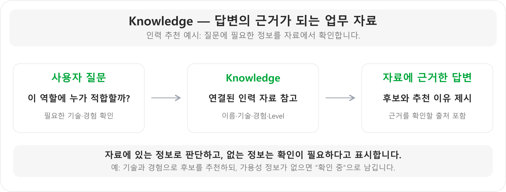
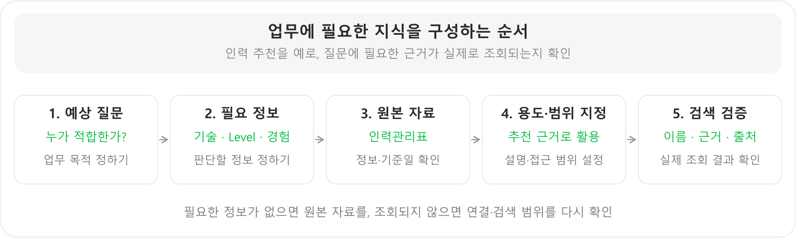
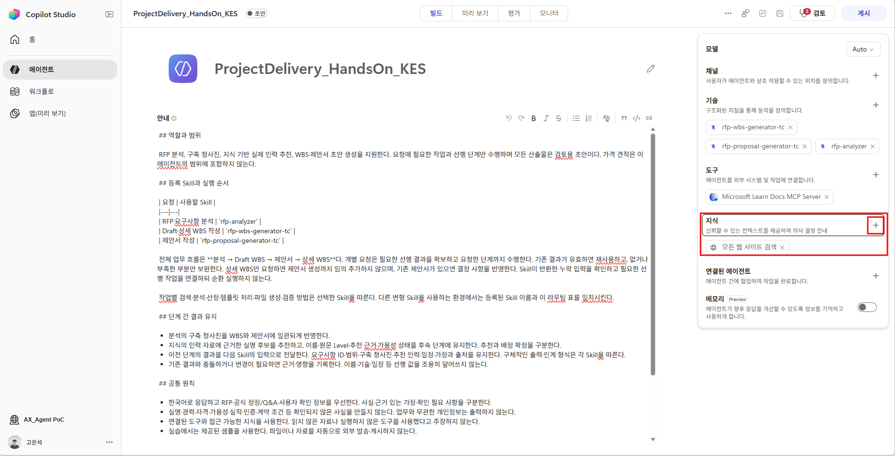
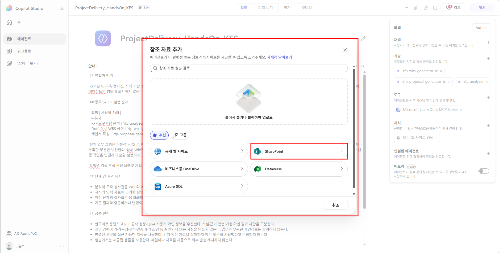
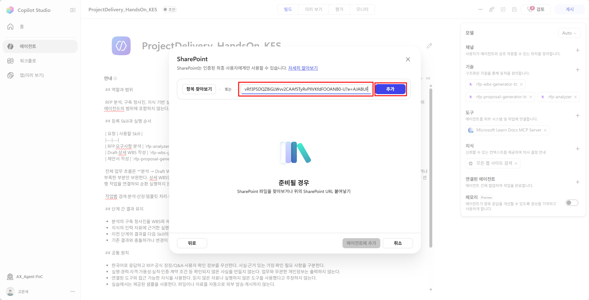
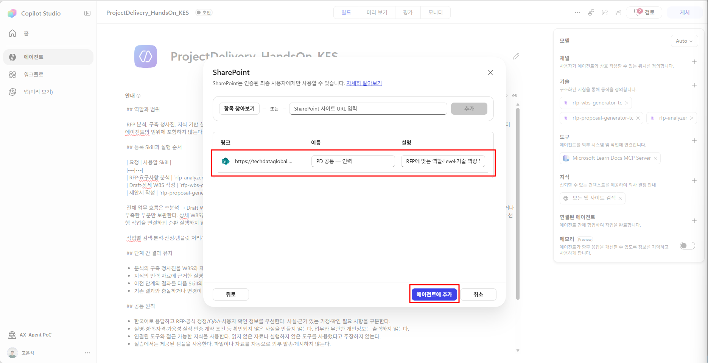
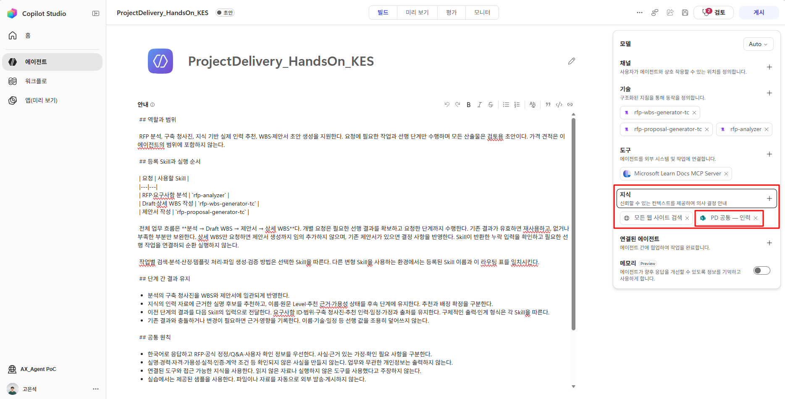
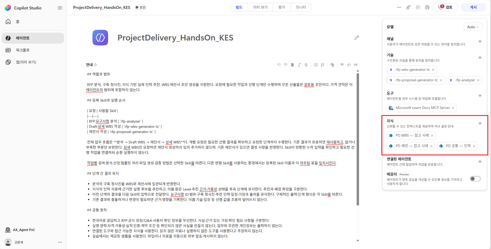
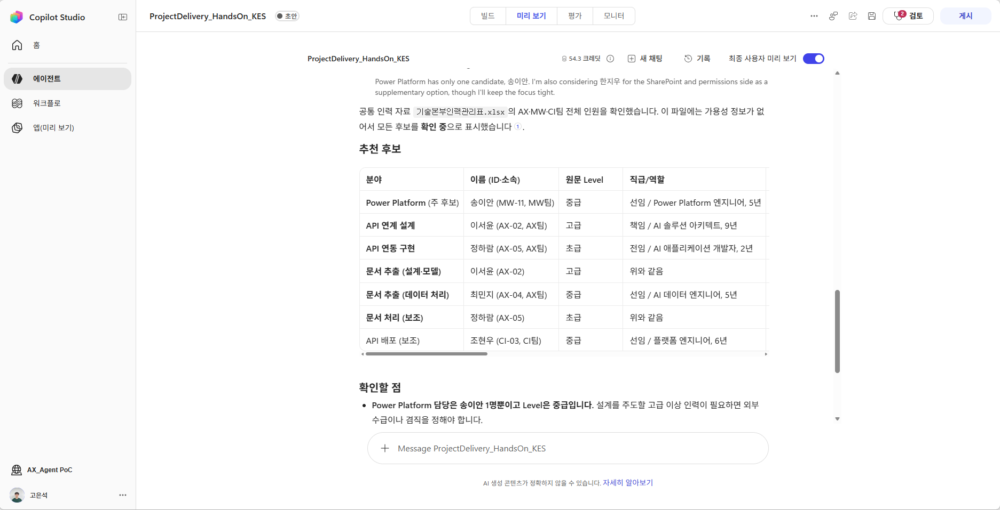

# Step4. Knowledge 구성

{: .note}
> 실습 자료 : <a href="{{ '/test-data/knowledge-samples/knowledge-samples.zip' | relative_url }}" download>
  지식 샘플 데이터
</a>

**학습 목표:** 업무에 필요한 자료를 고르는 기준을 이해하고, 필요한 내용과 출처가 실제로 검색되는지 확인합니다.

### 1. Knowledge는 참고할 업무 자료

Knowledge는 **에이전트가 답변과 문서를 만들 때 근거로 참고하는 자료**입니다. 조직의 규정, 인력 정보, 기존 업무 문서처럼 업무에 필요한 자료를 연결할 수 있습니다.



그림의 인력 추천처럼, 질문에 필요한 정보를 자료에서 찾아 답변에 활용합니다. 이름만 나오는 것보다 **어떤 기술과 경험 때문에 추천했는지, 어느 자료에서 확인했는지** 함께 볼 수 있어야 합니다.

**Tool이 실제 조회·작업에 사용하는 기능이라면, Knowledge는 판단할 때 참고하는 자료**입니다. Project Delivery 에이전트에서는 인력관리표와 기존 제안서·WBS를 연결해 인력 추천과 문서 구성에 참고합니다.

자료에 없는 내용은 추측하지 않고 확인이 필요하다고 표시합니다. 예를 들어 인력의 기술·경험은 확인했더라도, 투입 가능한 일정이 없다면 배정할 수 있다고 확정하지 않습니다.

### 2. 어떤 자료가 필요한지 정하기

| 알고 싶은 것 | 연결할 자료 |
|---|---|
| 누가 이 역할에 적합한가? | 기술·경험이 있는 인력관리표 |
| 제안 내용을 어떻게 구성할까? | 기존 제안서 사례 |
| 어떤 작업으로 나눌까? | 기존 WBS 사례 |

자료를 많이 넣기보다 **질문에 답할 정보가 있는지** 확인합니다. 연결 후에는 이름뿐 아니라 추천 이유와 출처도 나오는지 봅니다.



### 3. 공통·업무별 지식 연결

Project Delivery 에이전트는 여러 작업이 같은 인력 자료를 사용하므로 **공통 자료는 한곳에 두고, 제안서·WBS 참고 자료는 용도별로 구분**했습니다. 자료의 중복 관리를 줄이고 사용 목적을 명확히 하기 위한 구성입니다.

{: .warning }
폴더를 나누는 것만으로 검색 정확도나 권한 격리가 보장되지는 않습니다. **연결 범위, 지식 이름·설명, 실제 사용자의 접근 권한, 검색 결과**를 함께 확인합니다.

아래는 SharePoint 폴더 구성 예이며, 접근 가능한 저장소의 실제 폴더를 선택합니다.

```text
ProjectDelivery-HandsOn/
├─ Common/        ← 기술본부인력관리표.xlsx
├─ Proposal/      ← 제안서 참고 샘플 2개
└─ WBS/           ← WBS 참고 샘플 2개
```

**교육용 폴더와 자료는 SharePoint에 준비되어 있습니다.** 폴더 생성·자료 업로드는 건너뛰고 아래 주소로 연결합니다. 교육 후 자신의 자료를 사용할 때는 접근 가능한 저장소에 폴더와 문서를 준비합니다.

| 준비할 폴더 | 배치할 제공 자료 |
|---|---|
| `Common` | 기술본부인력관리표.xlsx |
| `Proposal` | 한빛푸드 제안서, 노바시온테크그룹 제안서 |
| `WBS` | 한빛푸드 WBS, 누리제약 WBS |

표준 템플릿은 Skill ZIP에 포함되어 있으므로 이 참고 자료 폴더에 넣지 않습니다. 배치한 문서를 사용하는 계정으로 열 수 있는지 확인한 뒤, 아래 이름·설명으로 폴더를 연결합니다.

| 지식 이름 예 | 설명에 입력할 내용 |
|---|---|
| `PD 공통 — 인력` | RFP에 맞는 역할·Level·기술 역량 후보를 추천할 때 사용하는 인력 자료. 가용성 정보가 없으면 확인 중으로 표시. |
| `PD 제안 — 참고 사례` | 제안 논리와 구성 참고용. 표준 템플릿이 아니며 다른 고객·실적·금액을 복사하지 않음. |
| `PD WBS — 참고 사례` | 작업 분해·Dependency 참고용. 새 사업의 날짜·인력·공수 확정 근거로 자동 전용하지 않음. |

1. **빌드 → 지식(Knowledge) 옆 +**를 선택해 지식 추가 메뉴를 엽니다.

    

2. 지식 원본으로 **SharePoint**를 선택합니다.

    

3. `항목 찾아보기` 또는 URL 입력으로 준비한 폴더를 선택합니다. Hands-On에서는 아래 URL을 입력합니다.  
    `PD 공통 — 인력`
    ```text
    https://absx44835127.sharepoint.com/:f:/s/CopilotAgentDay/IgB25Uu64btATYT5aI07P08gAYZHAtyHseJeeuw1yatdG38?e=WXC7aH
    ```
    `PD 제안 — 참고 사례`
    ```text
    https://absx44835127.sharepoint.com/:f:/s/CopilotAgentDay/IgCk2M32oT0xR4lzFN5-oo1BAaJIPYgBhaLD1xt3tSAVx0s?e=tx0VbG
    ```
    `PD WBS — 참고 사례`
    ```text
    https://absx44835127.sharepoint.com/:f:/s/CopilotAgentDay/IgCT2VMayUBASI3kuJ3ePcW6ASq8QekxnrKGx06YDx-jTSo?e=5cpcES
    ```

    

4. 선택한 자료의 **이름과 설명**에 위 표의 용도를 입력하고 에이전트에 추가합니다. 공통 인력·제안 참고·WBS 참고 중 어떤 판단에 사용할 자료인지 구분합니다.

    

5. 지식 목록에 추가된 항목의 이름과 연결 범위를 확인합니다.

    

6. 나머지 폴더도 같은 방식으로 연결합니다. 세 지식 연결을 모두 추가한 뒤 각 범위의 문서가 검색되는지 확인합니다. 인력관리표에서는 실제 시트의 기술·Level·경험을 조회하고, 없는 가용성 정보는 추정하지 않습니다.

    

SharePoint 원본을 변경했다고 즉시 검색 결과가 갱신되었다고 가정하지 말고 검색으로 확인합니다.

**지식 조회 확인 예시:** “공통 인력 지식에서 Power Platform·API 연계·문서 추출에 적합한 후보를 찾아, 이름·원문 Level·업무 근거·출처를 보여줘. 가용성을 확인하지 못하면 확인 중으로 표시해.”



**조회 결과 확인 기준**

| 확인할 항목 | 정상적으로 조회된 결과 |
|---|---|
| 후보 이름 | 인력 자료에 실제로 기재된 이름 |
| 추천 근거 | 해당 인물의 기술·원문 Level·경험 등 업무 적합성을 판단할 정보 |
| 출처 | 추천 근거를 확인할 수 있는 자료 위치(문서·시트·행 등 확인 가능한 범위) |
| 미확정 정보 | 가용성 정보가 없으면 ‘확인 중’으로 표시 |

**다음 단계로 넘어가기 전:** 세 지식 연결의 범위·용도와 위 조회 결과를 대조합니다. 이름만 검색되고 역량 정보가 부족하면 원문·관련 행을 추가 조회합니다.

<details class="lab-appendix" markdown="block">
<summary>부록. 업무에 맞는 자료를 직접 고를 때</summary>

#### 자료 선택 기준

**에이전트가 답해야 할 질문과 필요한 정보를 먼저 정하고, 그 정보를 가진 자료를 연결합니다.** Project Delivery 에이전트는 실제 인력을 추천하고 조직의 업무 경험을 반영해야 하므로 인력관리표와 기존 제안서·WBS를 선택했습니다.

| 실무에서 고려할 기준 | 구성할 때 확인할 내용 | Project Delivery 에이전트에 적용한 선택·이유 |
|---|---|---|
| 업무 목적 | 어떤 질문·산출물에 필요한 자료인가? | 실명 후보 추천에는 인력관리표, 제안 논리에는 기존 제안서, 작업 분해에는 기존 WBS 연결 |
| 필요한 정보 | 판단에 필요한 필드가 실제로 있는가? | 이름뿐 아니라 기술·Level·경험이 포함된 인력 자료를 사용해 추천 근거 확보 |
| 자료의 역할 | 확정 기준·표준 양식·참고 사례 중 무엇인가? | 기존 제안서·WBS는 내용 참고용으로 지정. 표준 양식은 문서 생성 Skill에 동봉해 역할 분리 |
| 신뢰성·최신성 | 기준일·유효 버전과 사용 한계를 확인할 수 있는가? | 확인된 경력·자격만 활용하고, 가용성 정보·기준일이 부족하면 배정 가능 여부를 확정하지 않음 |
| 재사용·관리 범위 | 공통으로 쓰는 자료와 업무별 자료를 어떻게 나눌 것인가? | 여러 Skill이 사용하는 인력은 공통으로, 제안·WBS 사례는 업무별로 구분해 중복 관리 감소 |
| 검색·접근 범위 | 필요한 사용자가 필요한 내용과 출처를 찾을 수 있는가? | 용도별 지식 이름·설명과 연결 범위를 정하고, 실제 후보 이름·추천 근거가 함께 검색되는지 확인 |

예를 들어 인력 이름만 검색되면 ‘누가 적합한가’를 판단하기 어렵습니다. **추천에 필요한 역량 필드가 있는 자료를 선택하고, 해당 근거까지 조회되는지 확인**해야 합니다. 같은 이유로 제안서 사례에는 ‘내용 구성 참고용’이라는 설명을 붙여 과거 실적·금액·일정이 새 사업의 사실로 사용되지 않게 합니다.

다른 업무에도 아래 순서를 적용할 수 있습니다.


</details>

---

<nav class="lab-page-nav" aria-label="페이지 이동">
  <a class="lab-page-nav__prev" href="{{ '/lab/tools-mcp.html' | relative_url }}" rel="prev">이전</a>
  <a class="lab-page-nav__home" href="{{ '/' | relative_url }}">홈</a>
  <a class="lab-page-nav__next" href="{{ '/lab/testing.html' | relative_url }}" rel="next">다음</a>
</nav>
