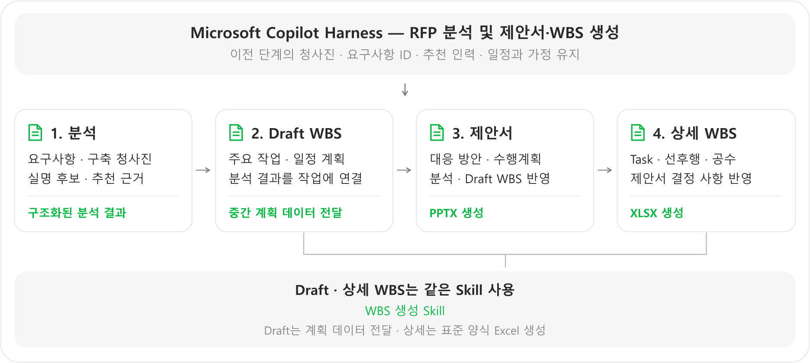
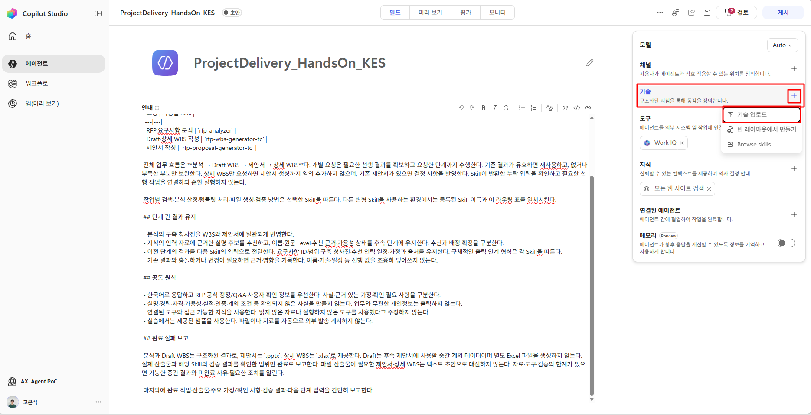
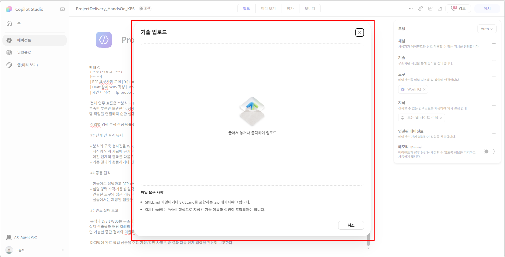
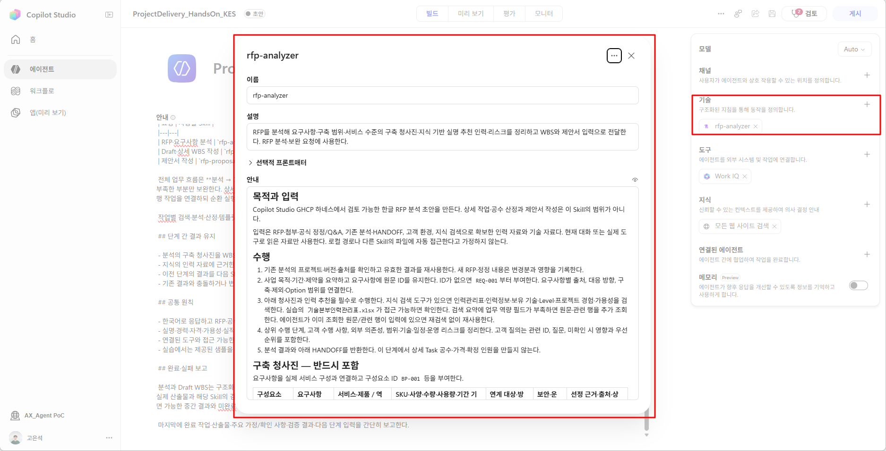
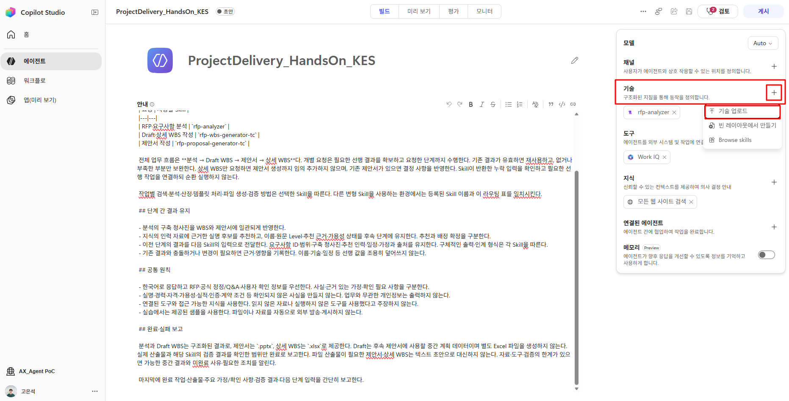
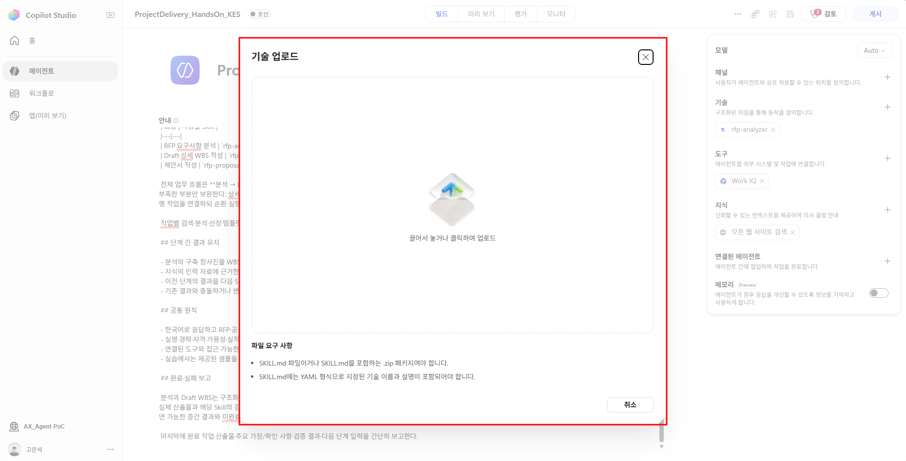
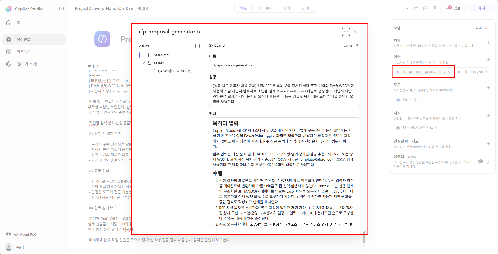
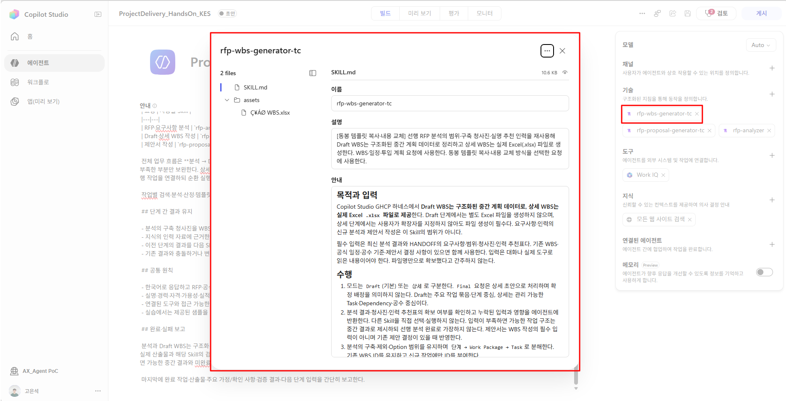
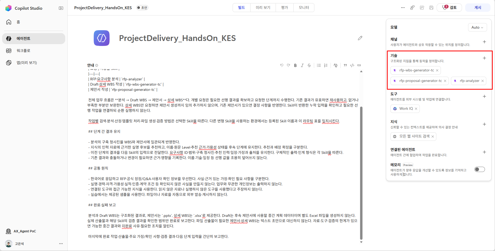

# Step2. Skills 구성

**학습 목표:** 업무별 입력·출력·완료 기준을 구분하고, 이전 결과를 이어 쓰도록 세 Skill을 등록합니다.

{: .note}
> 실습 자료 : <a href="{{ '/skills-Co/rfp-analyzer/rfp-analyzer.zip' | relative_url }}" download>
  rfp-analyzer ( RFP 분석 스킬)
</a>, 
<a href="{{ '/skills-Co/rfp-proposal-generator-tc/rfp-proposal-generator-tc.zip' | relative_url }}" download>
  rfp-proposal-generator-tc ( 제안서 작성 스킬)
</a>, 
<a href="{{ '/skills-Co/rfp-wbs-generator-tc/rfp-wbs-generator-tc.zip' | relative_url }}" download>
  rfp-wbs-generator-tc ( WBS 작성 스킬)
</a>

### 1. Skill 개요

Skill은 **하나의 업무를 수행하는 방법을 묶은 재사용 단위**입니다. 이 에이전트는 분석·WBS·제안서를 각각 다른 Skill로 구성합니다. [공식 Skill 개요](https://learn.microsoft.com/en-us/microsoft-copilot-studio/agents-experience/skills-overview)

### 2. 지침과 Skill의 역할 구분

**지침은 전체 업무의 목표·공통 원칙·실행 순서를, Skill은 특정 작업의 수행 방법을 담당합니다.** 같은 방법을 두 곳에 적으면 변경 시 서로 다른 규칙이 남을 수 있습니다.

| 구분 | 현재 에이전트와 제안서 생성 Skill의 예 |
|---|---|
| 에이전트 지침 | 제안서 요청에는 해당 Skill을 사용하고 이전 분석·Draft WBS의 청사진·인력·일정을 유지 |
| 제안서 생성 Skill | 동봉 PPTX를 복사해 양식을 유지하고 제안에 맞게 슬라이드를 구성한 뒤 내용·서식을 검증 |

### 3. 업무 분리 기준과 현재 에이전트의 구성

**하나의 명확한 목적과 완료 기준을 하나의 Skill로 묶습니다.** 작은 Task마다 Skill을 만들거나, 여러 산출물의 작성 방법을 한 Skill에 모두 넣지 않습니다.

| Skill | 맡은 작업 | 분리한 이유 |
|---|---|---|
| 분석 Skill | 요구사항·청사진·인력 추천 정리 | 모든 후속 작업이 사용할 기준을 한 번 정하기 위해 |
| WBS 생성 Skill | 분석 결과를 작업·일정·담당자로 구체화 | 일정·공수 계획의 책임을 분리하기 위해 |
| 제안서 생성 Skill | 분석·WBS를 고객에게 설명할 제안서로 구성 | 제안 표현을 바꾸면서 범위·일정까지 다시 만들지 않도록 하기 위해 |

이렇게 나누면 제안서의 구성이나 템플릿을 수정할 때 인력 분석·일정 산정까지 함께 고칠 필요가 줄어듭니다. 각 Skill에는 **해당 작업에 필요한 내용만** 넣고 다른 Skill의 수행 방법을 복사하지 않습니다.

### 4. 각 Skill의 업무 정의

Skill을 작성할 때는 긴 지시문보다 다음 구조부터 정합니다.

| 기본 구조 | 작성할 핵심 | 중요한 이유 |
|---|---|---|
| 이름·설명 | 어떤 요청에 사용할지 | 에이전트가 적절한 Skill을 선택하는 기준 |
| 입력·범위 | 필요한 선행 결과와 맡지 않을 작업 | 입력 누락과 역할 중복 방지 |
| 수행 절차 | 해당 업무에 필요한 핵심 작업 | 업무를 반복 가능한 방식으로 수행 |
| 출력·인계 | 결과 형식과 다음 작업에 넘길 정보 | 후속 단계가 바로 재사용할 수 있도록 구성 |
| 검증·예외 | 완료 기준과 부족·오류 처리 | 생성 결과의 품질과 실제 완료 여부 확인 |

Skill 정의 문서에는 목적·입력·절차·출력·검증 기준을 작성합니다. 템플릿 등 필요한 지원 자료를 함께 구성하고, 정의 문서에서 사용 방법을 명시합니다.

```text
Skill 구성
├─ 정의 문서  (.md 파일)    ← 이름·설명 + 입력·절차·출력·검증
└─ 지원 자료  (script,.pptx,.xlsx 등등)    ← 필요한 경우 템플릿 등 포함
```

**제안서 생성 Skill의 정의 예시**

<details class="lab-copy-details" markdown="block">
<summary>제안서 생성 SKILL.md</summary>

```text
---
name: rfp-proposal-generator-tc
description: "[동봉 템플릿 복사·내용 교체] 선행 RFP 분석의 구축 청사진·실명 추천 인력과 Draft WBS를 재사용해 기술 제안서·발표자료 초안을 실제 PowerPoint(.pptx) 파일로 생성한다. 제안서·제안 PPT·분석 결과의 제안 문서화 요청에 사용한다. 동봉 템플릿 복사·내용 교체 방식을 선택한 요청에 사용한다."
---

# 목적과 입력

Copilot Studio GHCP 하네스에서 무엇을 왜 제안하며 어떻게 구축·수행하는지 설명하는 한글 제안 초안을 **실제 PowerPoint `.pptx` 파일로 생성**한다. 사용자가 확장자를 별도로 지정하지 않아도 파일 생성이 필수다. RFP 신규 분석과 작업·공수 산정은 이 Skill의 범위가 아니다.

필수 입력은 최신 분석 결과·HANDOFF의 요구사항·범위·청사진·실명 추천표와 Draft 또는 상세 WBS다. 고객 지정 목차·평가 기준, 공식 Q&A, 제공된 Template·Reference가 있으면 함께 사용한다. 현재 대화나 실제 도구로 읽은 결과만 입력으로 사용한다.

# 수행

1. 선행 결과의 프로젝트·버전과 분석·Draft WBS의 확보 여부를 확인한다. 누락 입력과 영향을 에이전트에 반환하며 다른 Skill을 직접 선택·실행하지 않는다. Draft WBS는 선행 단계의 구조화된 표·HANDOFF 데이터로 받으며 Excel 파일을 요구하지 않는다. Draft 데이터로 충분하고 상세 WBS를 필수로 요구하지 않는다. 입력이 부족하면 가능한 제안 원고를 중간 결과로 작성하고 한계를 표시한다.
2. RFP 지정 목차를 우선한다. 별도 지정이 없으면 제안 개요 → 요구사항 대응 → 구축 청사진·상세 구현 → 보안·운영 → 수행계획·일정 → 인력 → 기대 효과·전제조건 순으로 구성한다. 장수는 내용에 맞춰 조정한다.
3. 주요 요구사항마다 `요구사항 ID → 청사진 구성요소 → 적용 서비스·선정 이유 → 구현 방법 → 고객 가치`를 설명한다. 출처 없는 정량 효과·실적·인증은 만들지 않는다.
4. 청사진의 구성요소 ID·서비스·SKU 후보·사양·수량 기준과 가정 상태를 그대로 반영한다. 아키텍처와 흐름도에는 구성요소, 연결 방향, 인증·데이터·모니터링·복구 관계를 표시한다. 도구가 허용하면 편집 가능한 도형을 사용하며, 도구가 없으면 텍스트 도식과 설명을 제공한다.
5. 분석의 아키텍처를 새로 설계하지 않는다. 보완이 필요하면 `[제안 단계 추가 제안]`과 관련 ID·근거·범위/일정 영향을 별도로 적고, 기존 기준 구성과 구분한다. 가정·후보를 확정 구성으로 바꾸지 않는다.
6. WBS의 단계명·기간·Milestone·Dependency·고객 협조 사항·산출물·역할을 수행계획에 재사용한다. 일정·공수·인원을 제안 단계에서 새로 산정하지 않는다.
7. 실명 인력 추천표를 다음 형식으로 제안서에 포함한다. 가용성 미확인 때문에 이름을 생략하거나 역할명만 남기지 않는다.

| 역할·책임 | 필요 Level | 추천 실명·원문 Level | 주 투입 단계 | 가용성·기준일 | 추천 근거·출처 / 대체 후보 |
|---|---|---|---|---|---|

`확인 중`은 `추천 후보 · 가용성 확인 중`, `투입 중`은 `추천 후보 · 타 프로젝트 투입 중, 일정 조정 필요`로 표기한다. `확정`은 선행 자료에 명시적으로 확인된 경우만 유지한다. 후보가 없으면 `[추천 인력 확인 필요]` 또는 `[외부 확보 필요]`를 승계한다. 이름·Level·경력·자격·가용성을 추가 생성하지 않는다.

# 필수 산출물 — PowerPoint(.pptx)

산출물은 `{고객사 또는 프로젝트명}_제안서_{YYYYMMDD}.pptx`다. 사용자 지정 파일명이 있으면 우선하며 확장자는 `.pptx`로 유지한다. 슬라이드별 제목·핵심 메시지·본문・도표와 관련 요구사항/청사진 ID를 반영한다. 요구사항 대응표, 구축 청사진·흐름, 수행 일정과 실명 인력 표, 주요 가정·확인 사항을 포함한다. 비용은 설계·사용량 변동의 영향과 Option 여부만 설명하며 금액은 산정하지 않는다. 계약 조건은 확인된 것만 인용하고 나머지는 `[고객 협의 필요]`로 남긴다.

대화에는 파일 첨부/다운로드 링크, 제안 핵심 내용, 주요 가정·확인 사항과 검증 결과를 요약한다. 슬라이드 개요·원고 또는 다른 형식의 확장자만 바꾼 파일로 완료 처리하지 않는다.

# PowerPoint 파일 생성 절차

## 동봉 템플릿 확보 — 동봉 템플릿 복사·내용 교체

- 이 Skill의 위치를 기준으로 `assets/표준제안서 템플릿_V2.pptx`을 사용한다. 실행 환경의 스킬 루트를 기준으로 상대경로를 해석하며 특정 로컬·서버 절대경로를 가정하지 않는다.
- 실행 전 동봉 파일에 실제 접근할 수 있는지 확인한다. 없으면 동봉 자료 누락과 필요한 원본을 에이전트에 보고한다.
- 템플릿은 지식에서 검색하지 않는다. 프로젝트 자료·인력 데이터는 기존과 같이 지식 또는 선행 HANDOFF에서 사용한다. 동봉 파일이 없다고 지식의 다른 템플릿으로 자동 대체하거나 생성 방식을 전환하지 않는다.
- 템플릿은 읽기 전용으로 취급하고 원본에 저장하지 않는다. 실제 하네스의 파일 생성·저장·첨부 도구를 사용한다. 아래 방식으로 실제 `.pptx`를 생성·검증해 제공한다.
- HANDOFF에 템플릿 방식 `copy`, Skill 이름, 동봉 상대경로, 원본 파일 식별자·해시(확보 가능한 경우), 생성·검증 상태를 기록한다.

### 템플릿 복사 후 양식을 유지하며 제안 내용 구성

- **동봉 원본을 출력 경로로 먼저 파일 복사**하고 복사본을 열어 편집한다. 빈 프레젠테이션에 원본 양식을 추측해 다시 그리지 않는다. 원본은 변경하지 않는다.
- **고정할 것은 양식이며 슬라이드 수·순서·내용은 제안서에 맞게 변경한다.** 슬라이드 크기, 마스터·테마, 폰트·색상·로고, 표지·목차·간지·헤더/푸터 등 공통 디자인을 원본에서 유지한다.
- 실제 원본의 레이아웃과 샘플 슬라이드를 확인한다. 표지·목차·간지·본문 등 필요한 유형의 기존 슬라이드를 복제하거나 원본의 적합한 레이아웃으로 슬라이드를 추가한다. 미사용 샘플·가이드 슬라이드는 삭제하고, RFP 목차와 제안 논리에 맞게 순서를 조정한다. 새 마스터·테마로 양식을 대체하지 않는다.
- 제목·본문·표·도형 레이블·데이터·아키텍처·흐름도를 선행 결과로 작성한다. 기존 양식의 콘텐츠 영역 안에서 표·도형·연결선 등 제안 내용을 추가·변경할 수 있으며 원본 디자인과 글꼴·색상 기준을 적용한다. 공통 디자인 요소를 지우거나 덮지 않는다.
- 내용이 한 장에 들어가지 않으면 같은 양식의 슬라이드를 복제·추가해 나눈다. 기존 장수에 맞추기 위해 핵심 정보를 누락하거나 글자를 과도하게 줄이지 않는다. 이전 고객 정보·Sample·입력 안내·불필요한 샘플 콘텐츠는 제거하고 목차와 페이지 번호를 최종 구성에 맞게 갱신한다.
- 원본과 **양식의 일치**를 검증한다. 슬라이드 수·순서·본문 도형 수의 동일성은 통과 기준이 아니다. 크기·마스터·테마·사용 레이아웃·공통 디자인·폰트·색상을 확인하고, 표지·목차·간지의 적용 및 샘플 제거·페이지 번호를 점검한다. 원본 불변과 복사본 재열기를 확인하고 렌더링으로 겹침·잘림·영역 이탈을 수정·재검증한다.


파일 존재·크기·PowerPoint 형식과 첨부/링크 접근 가능 여부를 확인한다. **실제 파일 생성 + 선택 방식의 필수 검증 통과 + 파일 제공**까지 완료해야 제안서 산출물 완료다.

파일 생성·검증 도구나 원본이 없으면 확보 가능한 경로를 확인한 뒤 부족한 도구·파일과 해결 방법을 보고하고 `제안서 .pptx 생성 미완료`로 표시한다. 제안 원고는 중간 결과로 제공할 수 있지만 최종 산출물을 대신하지 않는다. 실제 확인 없이 생성·시각 검증 완료라고 말하거나 내부 저장 경로만으로 파일을 제공했다고 주장하지 않는다.

# 인계와 완료 검증

`HANDOFF`에 프로젝트·버전·선행 분석/WBS의 위치·버전, 제안 대응 방안·관련 ID·보완 제안·가정·충돌과 생성 파일·검증 결과를 포함한다. 선행 요구사항·범위·청사진·실명 인력의 값은 유지한다. 선행 결과를 실제로 조회할 수 있으면 해당 자료와 신규·변경 정보를 연결하고, 조회할 수 없으면 다음 작업에 필요한 값을 직접 포함한다. 파일명이나 “앞 단계 참조”만으로 인계를 대신하지 않는다.

주요 요구사항의 대응 누락, 청사진과 다른 서비스·SKU, WBS와 다른 단계·일정, 실명·Level·가용성 상태 누락을 점검한다. 차이는 임의 수정하지 않고 근거·영향을 보고한다. 근거 없는 효과·계약 확약이나 확정 배정을 포함하지 않는다. 실제 생성 및 검증한 범위까지만 완료로 보고하며 자동 발송하지 않는다.
```

</details>

  
| 항목 | 현재 에이전트에 적용한 내용 |
|---|---|
| 입력 | RFP 분석 결과와 Draft WBS |
| 수행 절차 | 요구사항 대응·청사진·수행계획을 제안 내용으로 구성 |
| 출력 | 표준 양식을 적용한 `.pptx` 파일 |
| 완료 기준 | 기존 분석·WBS와 내용이 일치하고 파일·서식 검증 통과 |

이처럼 ‘제안서를 잘 작성한다’는 목표를 **무엇을 받아 어떻게 처리하고, 어떤 결과를 언제 완료로 볼 것인지**로 구체화합니다. 세부 방법은 제안서 생성 Skill에 정의하고, 에이전트 지침에는 같은 절차를 반복하지 않습니다.

**설계 시 확인할 세 가지:** 
1. 맡은 작업이 명확한가 
2. 입력·출력·완료 기준이 있는가, 
3. 지침이나 다른 Skill과 중복·충돌하지 않는가.  
    
원문의 길이보다 이 구조와 책임 구분이 중요합니다.


### 5. 여러 Skill의 결과 연결 — 이 에이전트의 사례

여러 Skill이 이전 작업의 결과를 이어 사용하는 업무에서는 **앞 단계의 출력이 다음 단계의 입력으로 활용되도록** 구성해야 합니다. 이 에이전트는 분석 결과를 WBS와 제안서에서 재사용하므로 단계 간 연결이 필요합니다.



Draft WBS는 주요 작업·일정을 구조화된 중간 계획 데이터로 정리해 제안서에 전달하고, 상세 WBS는 제안서의 결정 사항을 반영해 Task·선후행·공수를 구체화합니다. **같은 WBS Skill이 모드에 따라 입력·작성 수준·출력을 구분하며, 상세 단계에서 표준 양식의 `.xlsx`를 생성합니다.** 분석 결과는 모든 후속 단계에서 함께 사용합니다.

이 에이전트에서 유지할 핵심은 요구사항·구성요소 ID, 청사진, 후보 이름·Level·가용성, 일정과 가정·출처입니다. 상세 인계 형식은 각 Skill에 두고, 에이전트 지침에는 ‘이전 결과를 전달하고 유지한다’는 원칙만 둡니다.

기존 결과를 읽을 수 있으면 위치·버전을 연결하고 변경분을 전달합니다. 읽을 수 없다면 필요한 값을 직접 포함합니다. 파일명만 넘기거나 역할명만 남겨 추천 실명이 사라지지 않도록 합니다.


### 6. Skill 등록

등록할 Skill에 따라 업로드 파일 형식이 다릅니다.

| 등록할 Skill | 업로드할 파일 | 포함 내용 |
|---|---|---|
| 분석 Skill | 지침 문서(`.md`) | 분석 지침 |
| 제안서 생성 Skill | 템플릿 포함 패키지(`.zip`) | 지침 + PowerPoint 템플릿 |
| WBS 생성 Skill | 템플릿 포함 패키지(`.zip`) | 지침 + Excel 템플릿 |

{: .note }
> `.zip`은 템플릿을 함께 전달하기 위한 **Skill 등록 패키지**입니다.  
SKILL.md파일과 지원자료를 `.zip`으로 압축하여 업로드합니다.

#### 6.1 분석 Skill 등록 — `.md` 파일

1. 제공된 <a href="{{ '/skills-Co/rfp-analyzer/rfp-analyzer.zip' | relative_url }}" download>RFP 분석 Skill(rfp-analyzer.zip)</a>의 압축을 풀어, `SKILL.md`파일이 업로드할 Skill의 지침 문서 입니다.  
    {: .note}
    > 실습을 위해 `.md`파일을 업로드 하지만, `.zip`파일을 그대로 업로드하여도 무방합니다.
2. **빌드 → 기술(Skills) 옆 + → 기술 업로드**를 선택합니다.
    
3. 파일을 끌어 놓거나 업로드 영역을 클릭해 제공된 분석 Skill의 지침 문서(`.md`)를 선택합니다. **분석 Skill은 별도 동봉 파일 없이 `.md` 파일 하나를 업로드**합니다.
    
4. 이름·설명이 인식되고 목록에 분석 Skill이 표시되는지 확인합니다.
    

#### 6.2 제안서/WBS Skill 등록 — 템플릿을 포함한 `.zip` 파일

1. **빌드 → 기술(Skills) 옆 + → 기술 업로드**를 다시 선택합니다.
    
2. 제공된 <a href="{{ '/skills-Co/rfp-proposal-generator-tc/rfp-proposal-generator-tc.zip' | relative_url }}" download>제안서 작성 Skill(rfp-proposal-generator-tc)</a> 패키지를 선택하고, **압축을 풀지 않은 `.zip` 파일 그대로 업로드**합니다. 분석 Skill과 달리 지침 문서만 선택하지 않습니다.  
    
    {: .warning }
    > `.zip` 파일을 그대로 업로드하지 않고, `.md` 파일만 업로드하면 Skill이 지시하는 동봉 템플릿을 전달할 수 없습니다.  
3. 목록에 제안서 생성 Skill이 표시되는지 확인합니다.
    
4. 제안서 생성 Skill이 정상적으로 표시된다면, <a href="{{ '/skills-Co/rfp-wbs-generator-tc/rfp-wbs-generator-tc.zip' | relative_url }}" download>WBS 작성 스킬(rfp-wbs-generator-tc)</a>도 동일한 방법으로 스킬을 등록합니다.
    

각각의 패키지에는 아래와 같은 폴더 구조로 되어있습니다. 실행 시 동봉된 원본 템플릿을 복사해 제안서 양식을 유지합니다.

```text
제안서 생성 Skill 패키지(.zip)
├─ 업무 수행 지침(.md)
└─ assets/표준 제안서 템플릿(.pptx)

WBS 생성 Skill 패키지(.zip)
├─ 업무 수행 지침(.md)
└─ assets/표준 WBS 템플릿(.xlsx)
```

**확인:**  기술 목록의 세 이름이 에이전트 지침의 라우팅과 일치하는지 확인합니다.



<!-- 스킬 확인 화면 수정 필요 -->

기술 목록에 분석·제안서 생성·WBS 생성 Skill이 등록되어 있는지 확인합니다. 캡처의 표시 이름은 예시이며, 실제 등록된 Skill의 이름·설명과 에이전트 지침의 작업별 연결이 일치하는지 확인합니다. 사용할 템플릿 방식에 맞는 Skill만 등록하면 선택 혼선을 줄일 수 있습니다.

**다음 단계로 넘어가기 전:** 세 Skill의 등록 이름과 지침의 라우팅이 일치하고, 제안서·WBS ZIP에 원본 템플릿이 포함되어 있는지 확인합니다.

<section class="lab-appendix" markdown="block" aria-label="부록: 구축 사례">

### 부록. 구축 사례 — 표준 양식 적용을 위한 선택

아래는 실제 업무에서 템플릿 지정·작성 방식을 비교하며 얻은 경험입니다. 에이전트 구축 절차와 별도로, 양식 정확도와 관리 편의성 사이의 선택을 판단할 때 참고할 수 있습니다.

#### 1. 템플릿 지정 방식별 장단점

템플릿을 **어디에 두고 지정하는지**에 따라 세 방식으로 구분합니다. 양식의 복잡도와 변경 빈도, 원본 접근 경로를 기준으로 선택합니다.

| 방식 | Skill에서 지정하는 방법 | 장점 | 단점·트레이드오프 |
|---|---|---|---|
| A. Skill 지침에 직접 정의 | 열·좌표·폰트·수식 등을 Skill 본문에 기술 | 필요한 규격을 세밀하게 표현 가능 | 서식 표현이 복잡하고 지침이 길어져 작성·수정이 어려움 |
| **B. Skill에 템플릿 동봉** | 패키지에 템플릿 파일을 포함하고 지침에서 사용하도록 지정 | 복잡한 서식 정의 없이 템플릿과 지침을 함께 제공 | 스킬 패키지 제한, 템플릿 변경 시 스킬 패키지 갱신 필요 |
| C. 외부 저장소·지식 참조 | 지식의 이름·설명으로 양식을 선택하고 원본 확보 | 템플릿을 중앙에서 관리·교체하기 편리 | 검색·버전 선택·원본 가져오기가 정확도에 영향. 권한·인증 설계 필요 |


#### 2. 표준 양식을 일관되게 적용하기 위한 원본 복사

**목표는 제안서와 WBS에 회사 표준 양식을 실제로 적용해, 반복 생성해도 일관된 형식의 결과를 받는 것이었습니다.** 같은 템플릿을 동봉해도 Skill에서 파일 작성 방법을 어떻게 지시하는지에 따라 차이가 있었습니다.


참고 방식은 서식을 재현하면서 원본과 차이가 생길 수 있었습니다. 현재는 **원본 복사본에서 내용을 작성하고, 원본의 표준 요소가 유지되는지 검증**하도록 구성했습니다.

제안서는 양식을 유지하면서 슬라이드 수·순서·내용을 조정합니다. 핵심은 **표준 양식을 제대로 적용한 문서와 일관된 결과를 얻는 것**입니다.

</section>

---

<nav class="lab-page-nav" aria-label="페이지 이동">
  <a class="lab-page-nav__prev" href="{{ '/lab/agent-instructions.html' | relative_url }}" rel="prev">이전</a>
  <a class="lab-page-nav__home" href="{{ '/' | relative_url }}">홈</a>
  <a class="lab-page-nav__next" href="{{ '/lab/tools-mcp.html' | relative_url }}" rel="next">다음</a>
</nav>
