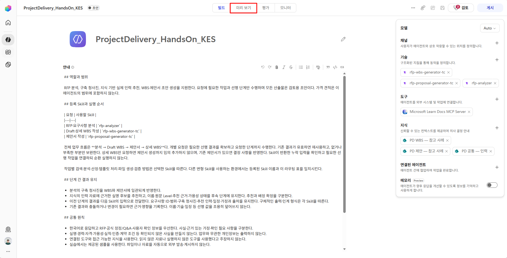
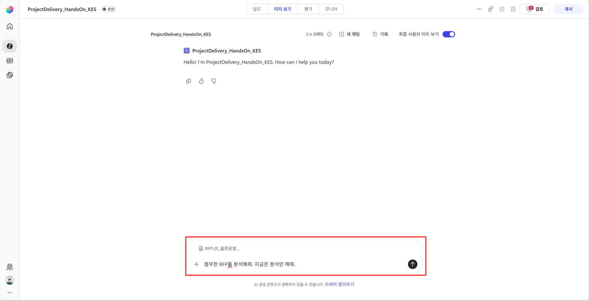
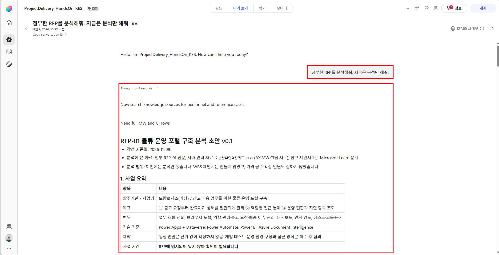
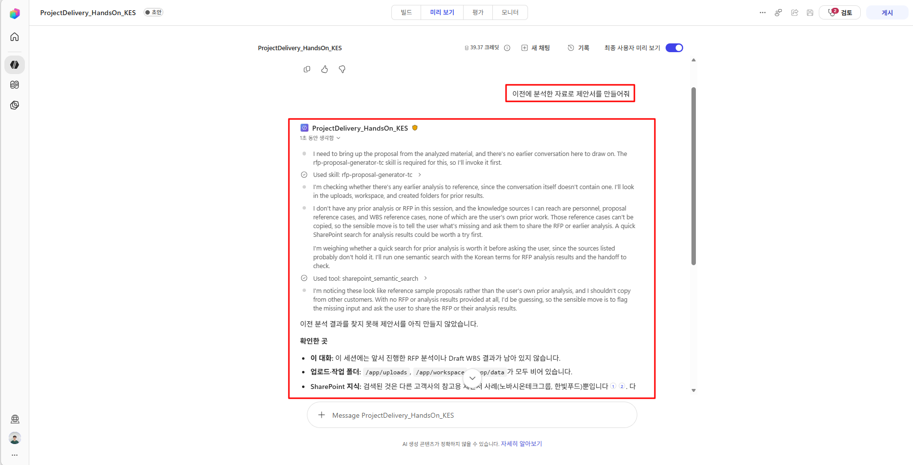
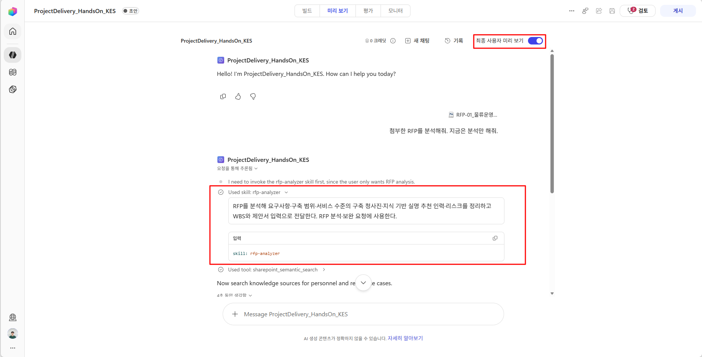
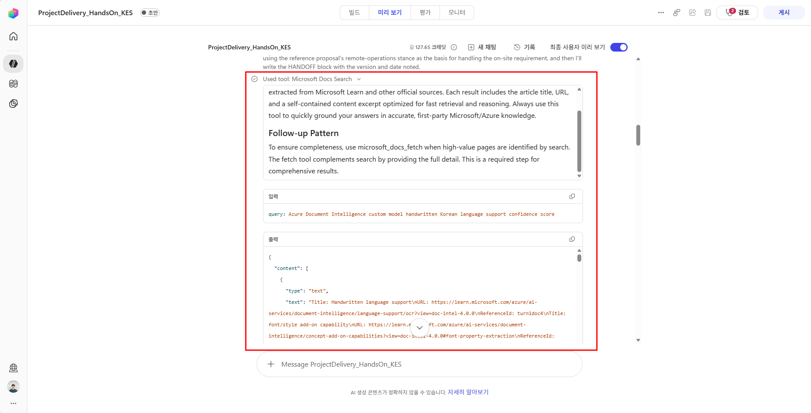

# Step5. 테스트 및 Activity Trace

**학습 목표:** 기대 결과와 실행 증거를 대조하고, 처음 어긋난 지점을 찾아 수정·재검증합니다.

에이전트 테스트는 **기대 동작과 실제 결과의 차이를 찾아 구성을 개선하는 과정**입니다. RFP 사례로 익힌 방법을 다른 업무에도 적용할 수 있습니다.

### 1. 테스트 전에 ‘무엇이 맞는 결과인지’ 정하기

요청마다 **입력 조건·기대 동작·확인할 증거**를 정합니다. 예를 들어 가용성 정보가 없는 인력 자료로 후보를 추천한다면, 자료에 있는 이름과 역량 근거를 제시하되 가용성은 ‘확인 중’으로 남겨야 합니다. 인력 자료·검색 결과·응답을 대조해 판단합니다.

실행 전에 기준을 정하고, 실행 후에는 3절의 점검 항목으로 실제 결과를 확인합니다.

### 2. 정상 흐름과 예외 상황을 함께 테스트하기

**기본 흐름을 먼저 확인하고, 이후 업무에서 중요한 조건을 골라 추가 검증합니다.** 요청에는 Skill 이름이나 처리 절차를 모두 알려주기보다 실제 사용자가 할 법한 표현을 사용합니다.

#### 기본 흐름 확인 — 현재 에이전트의 사례

**미리 보기(Preview)**에서 새 대화를 시작하고 RFP-01을 첨부합니다. 문서 앞의 ‘테스트 메타정보’는 고객의 확정 요구와 구분합니다.

아래 요청을 **같은 대화에서 순서대로** 실행하고, 기대 결과는 별도로 대조합니다.

| 순서 | 요청 예시 | 기대 결과 |
|---|---|---|
| 분석 | “첨부한 RFP를 분석해줘. 지금은 분석만 해줘.” | 요구사항·청사진·근거 있는 실명 후보·미확정 사항 정리. WBS·제안서 추가 생성 없음 |
| 제안서 | “이 분석을 바탕으로 제안서를 만들어줘.” | 같은 청사진·인력·일정을 반영하고 표준 양식을 적용한 PPTX 생성 |
| 상세 WBS | “제안서 내용을 반영해서 상세 WBS를 Excel 파일로 만들어줘.” | 기존 결과를 재사용해 Task·선후행·완료 기준을 구체화한 표준 양식의 XLSX 생성 |

앞 단계에 문제가 있으면 보완한 뒤 후속 결과를 확인합니다. 생성 중에는 Trace 상태를 확인하고 동일 요청을 중복 실행하지 않습니다.

#### 조건을 바꿔 추가 검증하기

| 유형 | 대화·입력 조건과 요청 예 | 기대 동작 |
|---|---|---|
| 입력 부족 | **새 대화**, RFP·분석 없이 “이전에 분석한 자료로 제안서를 만들어줘.” | 읽지 않은 결과를 추측하지 않고 필요한 입력 확인 |
| 정보 미확정 | **새 대화**, RFP와 가용성 미기재 인력 자료로 후보 추천 요청 | 실명·역량 근거 제시, 가용성은 ‘확인 중’ 유지 |
| 변경 요청 | **기본 흐름을 마친 대화**에서 “ERP 연계 범위가 바뀌었어. 관련 작업과 제안 내용을 수정해줘.” | 구체적인 변경 내용을 확인하고 관련 결과에 반영, 무관한 값 유지 |

더 확인하려면 새 대화에서 분석 요청의 표현을 바꾸거나 근거 없는 실적을 채워달라고 요청해 봅니다. 도구 오류는 별도 테스트 환경에서 재현 가능한 실패 사례로 확인합니다.

### 3. 답변·근거·산출물을 함께 확인하기

**원문·검색 결과·선행 데이터·실제 파일**을 대조해 차이를 기록합니다. 아래 RFP 예시는 해당 자료를 사용했을 때의 기준이며, 다른 업무에서는 요구사항에 맞게 정합니다.

| 점검 관점 | 대조할 내용과 RFP 사례 |
|---|---|
| 요구사항·범위 | 원문과 응답 비교. RFP-01의 요구사항 ID인 `LOG-01~10`, ERP 연계 전제·제외 범위 유지 여부 확인 |
| 판단 근거 | 추천 인력의 기술·Level이 자료와 일치하는지, 공식 문서의 지원 조건이 제안 주장을 뒷받침하는지 확인 |
| 단계 간 일관성 | 분석·Draft WBS·제안서·상세 WBS에서 ID·청사진·실명·가용성·일정 가정 대조 |
| 결과물·변경 반영 | 파일을 열어 XLSX 수식·선후행·간트, PPTX 양식·겹침·잘림·샘플 잔존과 요청한 변경 반영 확인 |

출처 URL이나 다운로드 링크가 있다는 사실만으로 통과시키지 않습니다. 실제 근거 내용과 파일을 확인합니다.

### 4. Activity Trace로 문제의 시작점 찾기

결과가 기대와 다르면 다음 순서로 실행 기록을 확인합니다.

1. Preview에서 **‘최종 사용자 미리 보기(End user preview)’를 끄고 작성자 화면으로 전환**하여, 문제가 발생한 요청의 Activity Trace를 엽니다. 이전 대화는 **기록(History)**에서 찾습니다.

    
<!--현재는 버그인지, 기술문서 설명/번역 오류인지 모르겠으나 설명과 반대로 동작함 !!! -->

2. 관련 실행 항목의 입력·결과·오류를 펼쳐 아래 증거를 대조합니다. [Activity Trace 디버깅](https://learn.microsoft.com/en-us/microsoft-copilot-studio/agents-experience/authoring-activity-trace)

    

| 확인할 실행 항목 | 분석 요청에서 찾을 증거 |
|---|---|
| Skill 선택 | 분석 Skill이 선택됐는가? 다른 작업이 선택됐다면 지침의 선택 조건·Skill 설명 확인 |
| 지식 조회 | 어떤 자료를 검색했고 이름·기술·Level 등 필요한 정보가 반환됐는가? |
| 도구 호출 | Learn MCP 등 필요한 도구의 호출 입력·반환 내용·오류는 무엇인가? |
| 후속 입력·파일 처리 | 이전 값이 실제로 전달·조회됐는가? 문서 생성 요청이라면 원본 확보·생성·저장·제공 중 어디서 실패했는가? |

기록에서 확인되지 않는 항목은 원문·선행 결과·산출물과 대조하고, 검증한 범위만 기록합니다.

{: .warning }
Trace의 실행 완료 표시는 업무 품질의 합격 판정과 별개입니다.

**진단 예 — 제안서에서 추천 인력 이름이 빠졌다면**

### 5. 원인에 맞게 수정하고 같은 조건으로 재검증하기

**처음 기대와 달라진 지점의 구성**을 수정합니다. 선택이 잘못됐다면 지침·Skill 설명, 수행 기준이 부족하면 해당 Skill, 필요한 정보가 없으면 자료·검색 범위, 호출 오류라면 Tool의 입력·연결·외부 오류를 확인합니다. 모든 문제를 지침 문장 추가로 해결하지 않습니다.

수정한 설정과 버전을 남기고 다음을 확인합니다.

1. **같은 조건:** 문제를 발견한 요청·자료로 다시 실행해 해결 여부 확인.
2. **후속 영향:** 제안서·상세 WBS 등 영향을 받는 결과에서도 값과 상태 유지 확인.
3. **다른 조건·기존 정상 사례:** 새 대화·다른 표현·다른 RFP에서도 동작하고, 기존 기능이 유지되는지 확인.

아래는 기록 방법을 보여주는 **가상 작성 예시**입니다.

| 요청·입력 조건 | 기대 결과 | 결과 차이·실행 증거 | 수정 영역·버전 | 재검증·후속 영향 |
|---|---|---|---|---|
| 가용성 미기재 자료로 후보 추천 | 실명·역량 근거와 ‘확인 중’ 표시 | 조회 결과에 가용성은 없지만 응답은 ‘배정 확정’ | 분석 Skill v2: 상태 판단·검증 기준 보완 | 같은 입력에서 ‘확인 중’ 표시. 후속 제안서·상세 WBS에도 유지 |

문장의 동일성보다 **사실·범위·근거·형식·상태가 기준을 충족하는지** 확인합니다. 결과가 흔들리면 같은 조건을 반복해 차이를 기록하고, 문제가 없었다면 통과 근거를 남깁니다.

---

<nav class="lab-page-nav" aria-label="페이지 이동">
  <a class="lab-page-nav__prev" href="{{ '/lab/knowledge.html' | relative_url }}" rel="prev">이전</a>
  <a class="lab-page-nav__home" href="{{ '/' | relative_url }}">홈</a>
  <a class="lab-page-nav__next" href="{{ '/lab/wrap-up.html' | relative_url }}" rel="next">다음</a>
</nav>
