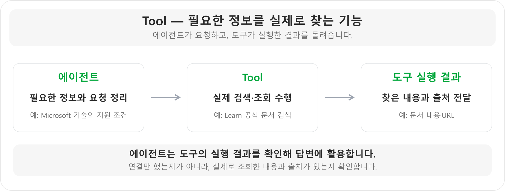
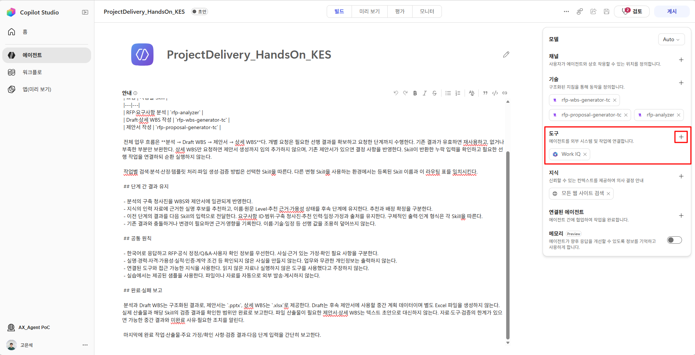
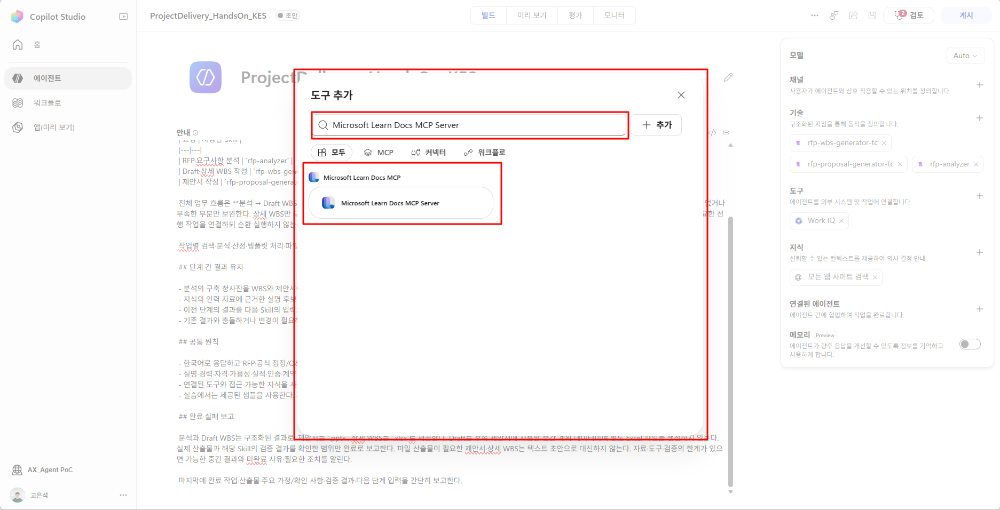
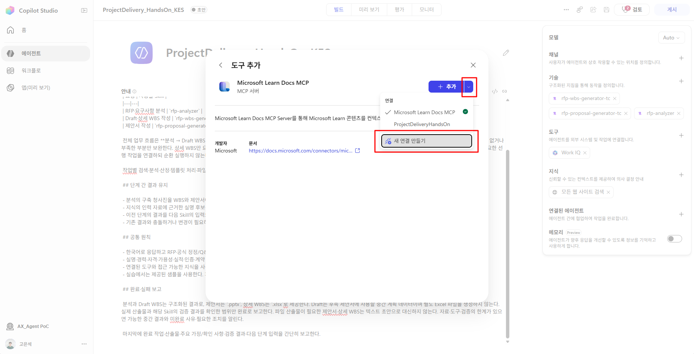
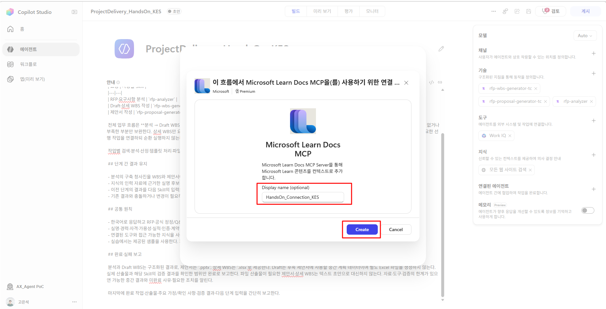
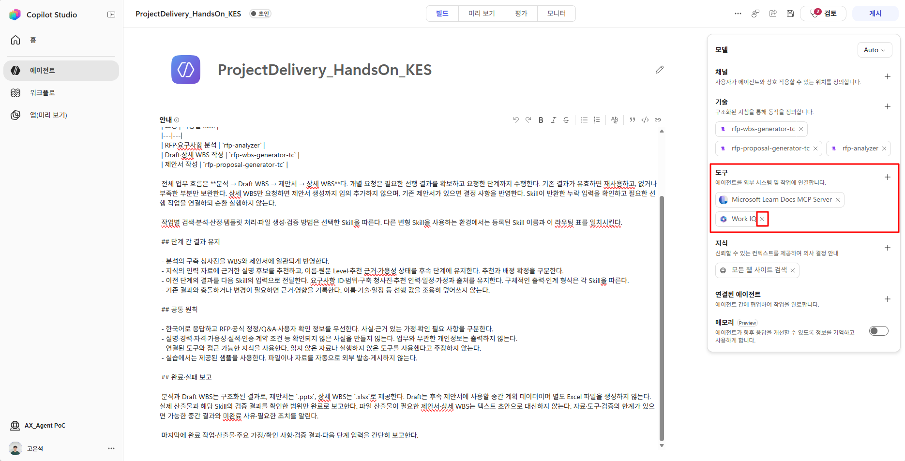
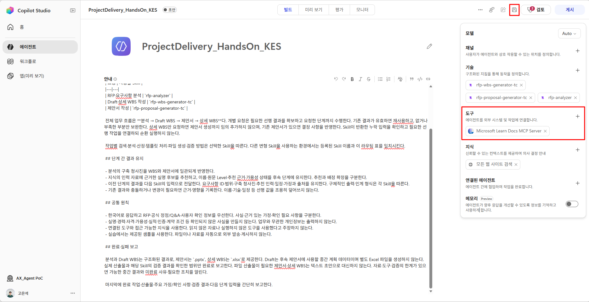
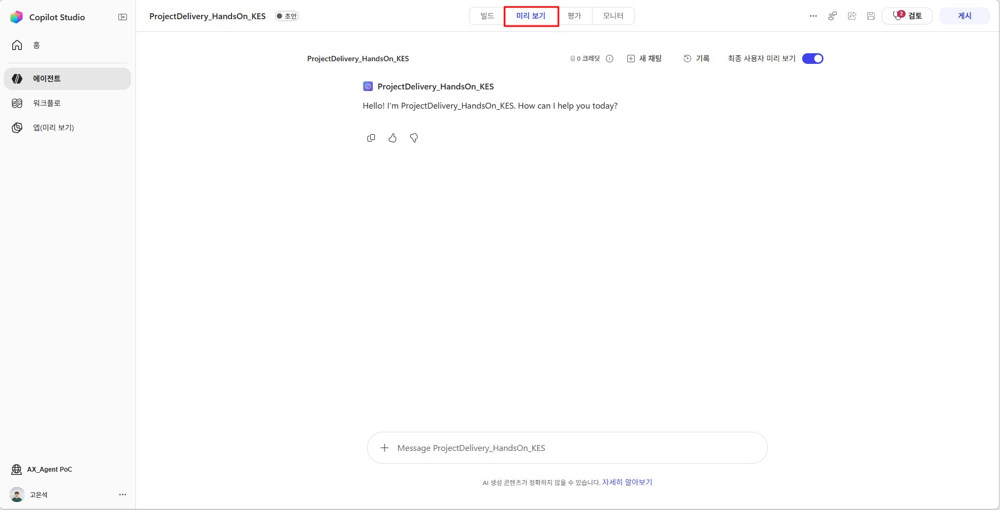
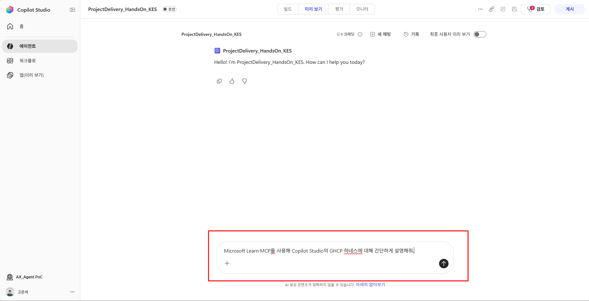
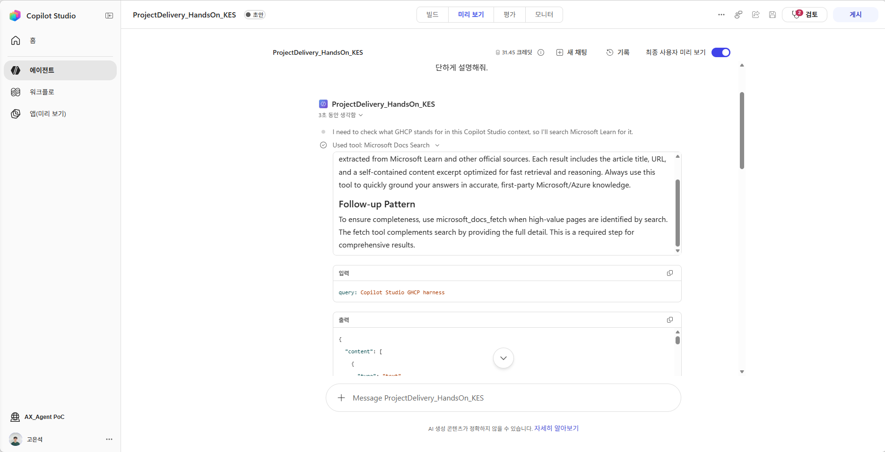

# Step3. Tools 등록 

**학습 목표:** 필요한 기능과 정보의 출처를 보고 도구를 고르는 기준을 알고, Learn 도구가 실제로 찾은 결과를 확인합니다.

### 1. Tool은 실제 작업에 쓰는 기능

Tool은 **에이전트가 정보를 찾거나 작업을 실행할 때 사용하는 기능**입니다. 예를 들어 문서를 검색하거나, 시스템에서 데이터를 조회하거나, 일정을 등록하는 기능을 연결할 수 있습니다.



그림처럼 에이전트가 필요한 정보를 요청하면 도구가 실제 검색·조회를 수행하고 결과를 돌려줍니다. 에이전트는 그 내용을 확인해 답변에 활용합니다.

**Skill에는 작업 방법을 적고, Tool로는 필요한 기능을 연결합니다.** 예를 들어 ‘공식 기술 문서를 확인한다’는 방법을 Skill에 적고, 문서를 찾는 기능은 Learn 도구로 연결할 수 있습니다.

### 2. Project Delivery 에이전트에 연결할 도구

Project Delivery 에이전트는 Microsoft 기술을 제안할 때 **실제로 지원되는 기능인지, 어떤 조건에서 사용할 수 있는지** 확인해야 합니다. 그래서 Microsoft 공식 문서를 검색·조회하는 **Microsoft Learn Docs MCP Server**를 연결합니다.

도구를 고를 때는 이름보다 **무슨 일을 할 수 있고, 어떤 정보를 돌려주는지** 살펴보면 도움이 됩니다.

| 살펴볼 점 | Project Delivery 에이전트의 선택과 확인 |
|---|---|
| 필요한 기능인가? | Microsoft 기술 문서를 검색하고 내용을 조회할 기능 선택 |
| 믿을 수 있는 출처인가? | 기술 제안의 근거로 Microsoft 공식 문서 사용 |
| 사용할 수 있는 연결인가? | 연결을 만들고 실제 문서 조회가 가능한지 확인 |
| 필요한 결과가 나오는가? | 문서 내용과 URL이 반환되고 제안 내용을 뒷받침하는지 확인 |

예를 들어 ‘이 기능을 제안해도 될까?’라는 질문에 기능 이름만 찾는 것으로는 부족합니다. **지원 조건이 적힌 문서를 읽고 제안에 맞는지 확인**해야 합니다. Learn 도구는 공식 기술 문서를 찾는 데 사용하고, 내부 인력이나 기존 업무 사례는 Knowledge로 연결합니다.

다른 업무에도 같은 기준을 적용할 수 있습니다. **해야 할 일을 먼저 정하고 → 필요한 기능을 연결하고 → 실행 결과를 확인**해 봅니다.

### 3. Microsoft Learn MCP Server 등록

1. **빌드 → 도구(Tools) 옆 +**를 선택합니다.
    

2. 카탈로그에서 `Microsoft Learn Docs MCP Server` 를 검색하여 선택합니다.
    

3. 서버 상세에서 연결 추가를 선택하고 연결 이름에 아래 이름을 입력합니다. `본인이니셜`은 본인의 이니셜로 바꿔 **만들기(Create)** 및 에이전트 추가를 완료합니다.
    ```text
    HandsOn_Connection_본인이니셜
    ```

    
    

4.  Project Delivery 에이전트에서 사용하지 않는 **Work IQ**가 목록에 있다면 제거한 후 저장합니다.
    
    

### 4. 도구 호출 확인

등록한 도구(Microsoft Learn MCP Server)가 잘 동작하는지 확인합니다.

1. 상단 Preview(미리 보기)를 선택합니다. 만든 에이전트를 테스트할 수 있는 공간이 보입니다.
    

2. 아래 요청을 프롬프트 입력창에 입력하여 실행합니다.
    ```text
    Microsoft Learn MCP를 사용해 Copilot Studio의 Microsoft Copilot Harness에 대해 간단하게 설명해줘.
    ```
    

3. Microsoft Learn MCP Server 도구를 호출하였는지, 답변에 이상이 있는지 확인합니다.
    

    {: .note }
    > `최종 사용자 미리 보기`는 에이전트의 테스트 화면 표시 방식을 전환하는 기능입니다.  
     실행 기록을 확인할 때는 도구 호출 항목이 보이는 표시 상태로 맞춥니다. 표시 방식은 에이전트의 실제 동작에 영향을 주지 않습니다.


**완료 확인:** 응답의 링크뿐 아니라 Trace에 실제 MCP 검색 호출과 결과가 있습니다. 필요한 근거를 확보했으면 불필요한 반복 검색을 하지 않습니다. 제품 기술은 Learn MCP, 내부 인력·경험은 Knowledge처럼 **업무별 근거에 맞는 도구·지식**을 선택합니다.

조회가 실패하면 도구 목록의 연결 상태, 호출 입력과 오류 내용을 먼저 확인합니다. 호출은 성공했지만 근거가 부족하면 검색어를 구체화하거나 필요한 본문을 조회합니다.

**다음 단계로 넘어가기 전:** 도구가 목록에 있는지만 보지 말고, 실제 호출과 반환된 공식 문서 내용·URL까지 확인합니다.

<details class="lab-appendix" markdown="block">
<summary>부록. 도구 선택 기준 자세히 보기</summary>

#### 도구를 직접 선택할 때

**업무에 필요한 행동과 근거를 먼저 정하고, 이를 수행할 도구를 선택합니다.** Project Delivery 에이전트에서는 Microsoft 제품·서비스에 대한 제안을 공식 기술 문서로 뒷받침해야 하므로 Microsoft Learn MCP를 연결했습니다.

| 실무에서 고려할 기준 | 구성할 때 확인할 내용 | Project Delivery 에이전트에 적용한 선택·이유 |
|---|---|---|
| 필요한 행동 | 검색·조회·계산·생성·수정 중 무엇이 필요한가? | 요구사항의 구현 가능성과 기술 제안 근거를 확인할 문서 검색·본문 조회 기능 선택 |
| 신뢰할 출처 | 어떤 원천의 정보로 판단해야 하는가? | MS 파트너 업무의 기술 제안을 뒷받침하기 위해 Microsoft 공식 문서를 조회하는 Learn MCP 선택 |
| 입력·반환 결과 | 다음 작업에서 사용할 내용과 출처가 반환되는가? | 요구사항·기술명을 검색어로 사용하고, 반환된 문서 내용·URL을 청사진과 제안의 근거로 활용 |
| 기능·접근 범위 | 목적에 맞는 기능과 필요한 권한만 연결했는가? | 공식 기술 문서 조회에 맞는 도구를 연결. 내부 인력·사례는 별도 Knowledge로 구분 |
| 호출·검증 기준 | 언제 호출하고 어떤 결과를 확인할 것인가? | 기술의 지원 조건·제약 확인이 필요할 때 조회하고, Trace의 호출 결과와 산출물에 반영된 근거를 대조 |

예를 들어 문서 추출을 제안한다면 ‘해당 기능이 있다’는 답만으로는 부족합니다. 샘플 검증·사람 검수 등 적용 조건을 확인해야 하므로 **검색 후 필요한 본문까지 조회할 수 있는 도구**를 선택한 것입니다.

다른 업무에도 같은 순서로 적용합니다. 필요한 행동을 정하고, 그 행동을 수행할 도구의 입력·출력·접근 범위를 확인한 뒤, 결과가 실제 후속 작업에 쓰이는지 검증합니다. 도구 이름·설명과 Skill의 호출 조건에도 이 목적을 일치시킵니다.

</details>

---

<nav class="lab-page-nav" aria-label="페이지 이동">
  <a class="lab-page-nav__prev" href="{{ '/lab/skills.html' | relative_url }}" rel="prev">이전</a>
  <a class="lab-page-nav__home" href="{{ '/' | relative_url }}">홈</a>
  <a class="lab-page-nav__next" href="{{ '/lab/knowledge.html' | relative_url }}" rel="next">다음</a>
</nav>
